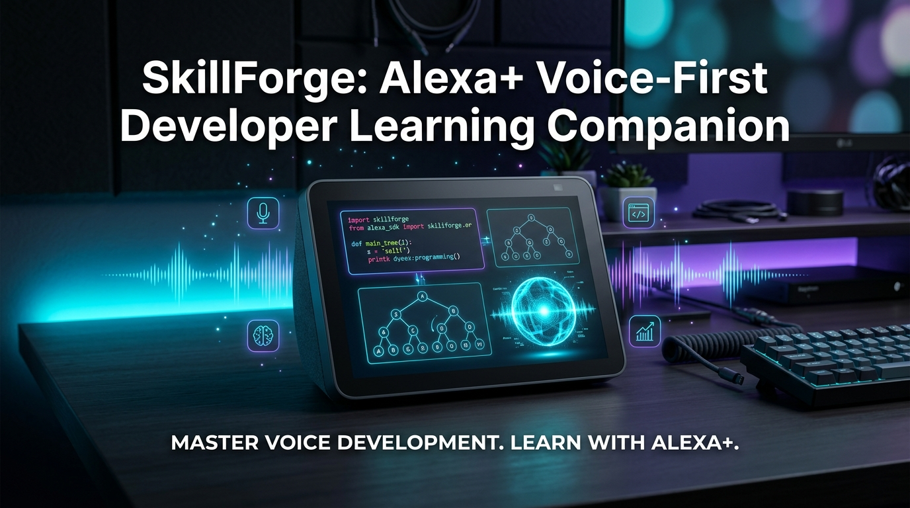
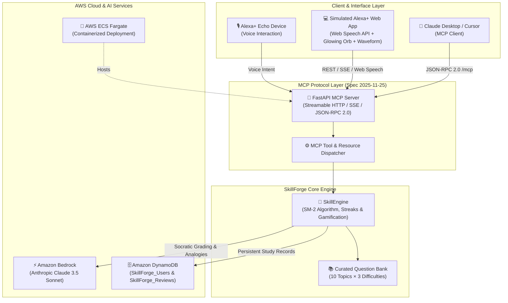

<p align="center">
  
</p>

<p align="center">
  
</p>

# ⚡ SkillForge — Voice-First Developer Learning Companion for Alexa+


> **Winner-ready submission for the Amazon Developer Hackathon 2026**  
> *Primary Track:* **Alexa+ (Self-Hosted MCP Server Spec 2025-11-25 & Simulated Web Experience)**  
> *Mini Challenges:* **AWS Builder** (Amazon Bedrock Claude 3.5 Sonnet, DynamoDB, ECS Fargate) & **Open Source** (MIT License)

[](LICENSE)
[](https://modelcontextprotocol.io)
[](https://python.org)
[](https://fastapi.tiangolo.com)
[](tests/)
[](https://developer.amazon.com/docs/alexa-presentation-language/apl-overview.html)


---

## 🌟 Concept Overview

**SkillForge** is an AI-powered, voice-first Data Structures & Algorithms (DSA) training companion built for **Alexa+** and powered by **Amazon Bedrock** (Anthropic Claude 3.5 Sonnet).

Instead of passively reading code on a screen, developers verbally quiz themselves on algorithmic patterns while commuting, cooking, or relaxing on the couch:
> *"Alexa, quiz me on dynamic programming."*  
> *"Alexa, explain Kadane's algorithm with a real-world analogy."*  
> *"Alexa, check my study streak."*

### Why Voice-First for DSA?
1. **Verbal Articulation:** Real tech interviews (Amazon SDE, Meta, Google) evaluate how clearly candidates explain time/space complexities and algorithmic trade-offs out loud.
2. **Combat Screen Fatigue:** Software engineers stare at IDEs all day. SkillForge enables hands-free voice study away from the monitor.
3. **Permanent Retention via SM-2:** Implements the scientific **SuperMemo SM-2 Spaced Repetition Algorithm** so you review flashcards right before you are about to forget them.

---

## 🏛️ System Architecture



---

## 🛠️ MCP Protocol Specification (Spec 2025-11-25)

SkillForge exposes a compliant **Streamable HTTP & SSE transport** (`/mcp/sse`, `/mcp/messages`, and `/mcp`) compatible with Alexa+, Claude Desktop, and modern AI coding assistants.

### 1. Registered MCP Tools (8 Tools)
| Tool Name | Description | Key Arguments |
|-----------|-------------|---------------|
| `quiz_me` | Generates interactive voice quiz questions on any DSA topic | `topic`, `difficulty`, `num_questions` |
| `explain_concept` | Explains algorithms with vivid real-world analogies using Bedrock | `topic`, `style` |
| `evaluate_answer` | Socratic grading of candidate answers with SM-2 scheduling | `question_id`, `answer` |
| `suggest_next` | Identifies next due flashcard via SuperMemo SM-2 algorithm | `user_id` |
| `check_streak` | Calculates active streak, user level, accuracy, XP, and badges | `user_id` |
| `daily_challenge` | Deterministic daily rotating algorithmic problem | `user_id` |
| `get_hint` | Delivers progressive Socratic hints without spoiling answers | `question_id`, `hint_level` |
| `mock_interview` | Simulates a FAANG voice technical screen | `company`, `role`, `topic` |

### 2. Registered MCP Resources (3 Resources)
* `skillforge://progress/overview`: Real-time user progress, streak, XP, and badge breakdown.
* `skillforge://topics/catalog`: All 10 curated DSA topics with question inventory.
* `skillforge://reviews/due`: Flashcards due for spaced repetition review today.

### 3. Registered MCP Prompts (3 Prompts)
* `study_session`: Structured 15-30 minute focused algorithmic review session.
* `interview_prep`: Company-targeted mock interview drill.
* `socratic_coach`: Voice mentor guiding learners with progressive inquiries.

---

## 🔬 SuperMemo SM-2 Spaced Repetition Algorithm

SkillForge implements the standard **SuperMemo SM-2 algorithm** for interval scheduling:

$$\text{Interval: } I(1) = 1, \quad I(2) = 6, \quad I(n) = \text{round}(I(n-1) \times EF)$$

$$\text{Ease Factor: } EF' = \max\Big(1.3, \, EF + (0.1 - (5 - q) \times (0.08 + (5 - q) \times 0.02))\Big)$$

* Where $q \in [0, 5]$ is the response quality evaluated by **Amazon Bedrock**:
  * **$q \ge 3$:** Correct answer. Repetition count increments, interval expands.
  * **$q < 3$:** Incorrect answer. Repetitions reset to $0$, interval resets to $1$ day for immediate reinforcement.

---

## 📚 10 Curated DSA Topics (Beginner to Advanced)

1. **Arrays & Two Pointers** — Prefix sums, two-pointer inward search, Kadane's algorithm, Trapping Rain Water.
2. **Linked Lists** — Fast/slow pointer (Floyd's cycle detection), in-place list reversal, merge $k$ sorted lists.
3. **Trees & BST** — Ancestor boundary checks, in-order traversals, lowest common ancestor.
4. **Graphs & Pathfinding** — BFS level-order, Dijkstra's algorithm, Kahn's topological sort, Tarjan's SCC.
5. **Dynamic Programming** — Overlapping subproblems, optimal substructure, 0/1 knapsack, Levenshtein distance.
6. **Sorting Algorithms** — Quicksort pivot selection, merge sort stability, non-comparison counting sort.
7. **Searching & Binary Search** — Rotated array search, search space elimination, median of two sorted arrays.
8. **Stacks & Queues** — Monotonic stacks (Largest Rectangle in Histogram), two-stack queue amortized $O(1)$, min-stack.
9. **Hash Tables & Sets** — Separate chaining vs open addressing, double hashing, load factor degradation.
10. **Strings & Pattern Matching** — Two pointers, sliding window substring, Knuth-Morris-Pratt (KMP) LPS array.

---

## 🚀 Quick Start Guide

### Prerequisites
- Python 3.11+
- (Optional) AWS Credentials configured with Amazon Bedrock access

### 1. Installation
```bash
git clone https://github.com/your-username/skillforge.git
cd skillforge

# Create virtual environment
python3 -m venv .venv
source .venv/bin/activate

# Install dependencies
pip install -r requirements.txt
```

### 2. Run the Server & Web Simulator
```bash
uvicorn main:app --host 0.0.0.0 --port 8000 --reload
```
Open your browser at **`http://localhost:8000`** to launch the **Simulated Alexa+ Voice Experience**!
- 🎙️ **Voice:** Tap the glowing mic to talk using Web Speech recognition and Alexa voice synthesis.
- 📡 **MCP Inspector:** Watch real-time JSON-RPC 2.0 messages flow on the right panel.
- 📇 **SM-2 Deck:** Review flashcards and watch intervals update live.
- 📖 **Interactive API Docs:** Visit `http://localhost:8000/docs`.

### 3. Run the Test Suite (31/31 Passing)
```bash
pytest -v
```

### 4. Run via Docker / Docker Compose
```bash
docker-compose up --build
```

---

## 🤖 Connecting to Claude Desktop / Cursor

Add SkillForge to your `claude_desktop_config.json`:

```json
{
  "mcpServers": {
    "skillforge": {
      "command": "python",
      "args": ["/absolute/path/to/Skillforge/main.py"],
      "env": {
        "AWS_REGION": "us-east-1"
      }
    }
  }
}
```

Or connect over Streamable HTTP:
```json
{
  "mcpServers": {
    "skillforge-http": {
      "url": "http://localhost:8000/mcp"
    }
  }
}
```

---

## ☁️ AWS Builder Architecture (Mini Challenge)

SkillForge features deep native AWS integrations:
1. **Amazon Bedrock (Claude 3.5 Sonnet):** Invoked via `boto3` (`bedrock-runtime`) for Socratic answer grading, real-world analogies, and voice question generation.
2. **Amazon DynamoDB:** Persistent tables (`SkillForge_Users` and `SkillForge_Reviews`) for tracking study streaks and SM-2 flashcard intervals with zero maintenance.
3. **AWS ECS Fargate & CloudFormation:** Production-ready `template.yaml` and `Dockerfile` for serverless container deployment with fine-grained IAM task execution roles.
4. **Resilient Local Fallback:** Automatically switches to in-memory/local JSON storage and pedagogical fallback when offline or running without AWS credentials, guaranteeing zero crash risk during judging reviews.

---

## 👥 Hackathon Reviewers Collaborators

For private repository submission, invite the required Amazon Developer Relations team members:
- `testing@devpost.com`
- `chris-trag`
- `knmeiss` (Kourtney Meiss)
- `giolaq` (Giovanni Laquidara)
- `anishamalde` (Anisha Malde)
- `mosesroth` (Moses Roth)
- `emersonsklar` (Emerson Sklar)

---

## 📄 License

This project is licensed under the **MIT License** — see the [LICENSE](LICENSE) file for details. Built with ❤️ for the global Amazon Developer Hackathon 2026.
